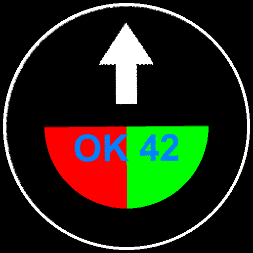
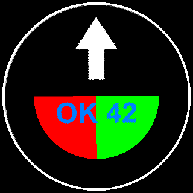

# holo_pd42_converter

Convert images, GIFs and videos into the native file format of the **Holoscope PD42** (42 cm) holographic LED fan, without the official Holoscope app.

The stock files for this fan have the `.mp4` extension, but they are not MP4 videos. They use a proprietary, pre-rendered polar format that the fan plays directly from its SD card. This project documents that format and provides a small Python tool that writes and reads it.

<p align="center">
  
  
</p>

## Features

- **Still images** (PNG, JPG, BMP, WebP, ...): the image is repeated for a fixed number of frames.
- **Animations**: animated GIF/WebP, any video ffmpeg can read (MP4, MOV, MKV, AVI, WebM, ...), or a folder of numbered images.
- **Decoder / previewer**: renders any fan file, including the stock ones, as a PNG or an animated GIF, showing the image as it looks from the front of the fan.
- **Adjustments**: fit/crop, rotation, mirroring, gamma and brightness.

## Requirements

- Python 3.8+
- `numpy` and `Pillow` (see `requirements.txt`)
- [ffmpeg](https://ffmpeg.org/) in your `PATH`, needed only for video input

```bash
pip install -r requirements.txt
```

## Usage

### Encode

```bash
# still image
python holo_pd42.py encode logo.png logo.mp4

# animated GIF / WebP
python holo_pd42.py encode animation.gif animation.mp4

# video (requires ffmpeg)
python holo_pd42.py encode clip.mov clip.mp4 --fps 24

# folder of numbered frames (001.png, 002.png, ...)
python holo_pd42.py encode frames/ sequence.mp4
```

Copy the generated `.mp4` file to the fan's SD card next to the stock files.

| Option | Default | Description |
|---|---|---|
| `--frames N` | 119 | Number of frames written for a still image |
| `--fps F` | source | Resample video input to `F` frames per second |
| `--max-frames N` | no limit | Stop after reading `N` input frames |
| `--fit contain\|cover` | `contain` | `contain` keeps the whole image with black borders; `cover` crops it to fill the circle |
| `--rotate DEG` | 0 | Rotate the image |
| `--mirror` | off | Mirror horizontally (the default output already has the correct orientation on the device) |
| `--gamma G` | 1.0 | Gamma correction (for example, `2.2` darkens midtones) |
| `--brightness B` | 1.0 | Brightness multiplier |
| `--no-pad` | off | Do not pad the frame count to `12k + 11` (see the format notes) |

### Decode / preview

```bash
# one frame as PNG
python holo_pd42.py decode clip.mp4 preview.png --frame 30

# whole file as an animated GIF
python holo_pd42.py decode clip.mp4 preview.gif --gif
```

The decoder also prints the header and trailer and checks whether the trailer is valid.

### Tips

- **Black = LED off = transparent.** Content on a black background gives the best holographic effect.
- Only the **inscribed circle** of the frame is visible. Keep important content away from the corners.
- Each frame is 141,120 bytes (about 3.4 MB per second at 24 fps). Use `--max-frames` or `--fps` to keep files small.
- The file does not store a playback rate. If an animation plays too fast or too slow, encode it again with a different `--fps`.

## File format

All values below were reverse-engineered from the stock content shipped with the fan.

### Container

```
offset 0        4 bytes          header: 01 00 00 00
offset 4        N × 141120 bytes frames
end - 8         8 bytes          trailer: 5A 91 | N (uint32, big-endian) | XOR of the 4 bytes of N | F5
```

In every stock file, the frame count N has the form `12k + 11` (for example 95, 119, 191 or 299), so the encoder pads to that by default. A few stock files have a trailer count slightly larger than the real number of frames, so the device does not seem to check it strictly.

### Frame

The propeller has **two opposite arms with 128 RGB LEDs each**. A frame contains **245 rows**. Each row is one "diameter" (both arms at once), and the 245 rows together sweep **180°**, so both arms together cover the full circle.

```
frame = 245 rows × 576 bytes
row   = 6 bit planes × 96 bytes          (plane 0 = MSB → 6 bits per color channel)
plane = 64 groups × 12 bits              ([R nibble][G nibble][B nibble])
```

Inside each nibble, the 4 bits address 4 segments of 64 LEDs at the same time:

| Nibble bit | Segment | LEDs |
|---|---|---|
| 3 (MSB) | seg0 | arm A, LEDs 64–127 |
| 2 | seg1 | arm A, LEDs 0–63 |
| 1 | seg2 | arm B, LEDs 0–63 |
| 0 (LSB) | seg3 | arm B, LEDs 64–127 |

So group `j` of a plane carries LED `j` of seg1 and seg2 and LED `64 + j` of seg0 and seg3, for each color channel.

- LED 0 of each arm is at the **outer edge**, and LED 127 is at the **center**.
- On row `a`, arm B points at angle `π·a/245`, measured from the horizontal axis. Seen from the front of the fan, the angle increases to the left (with y pointing down). Arm A points the opposite way (`+π`).
- Each color channel has 64 levels (6 bits), stored as 6 binary-weighted bit planes in order from MSB to LSB.

The stock files appear to use dithering (error diffusion) to smooth gradients. This encoder does not dither.

## License

[MIT](LICENSE)

## Disclaimer

This is an unofficial, community project with no affiliation to Holoscope or the fan's manufacturer. It has only been tested on a PD42 (42 cm, 2 × 128 LEDs). Other models probably use different geometry. Use it at your own risk.
